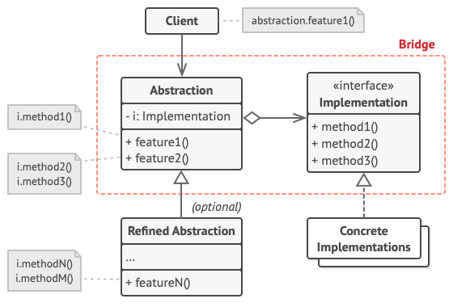

# Bridge
Bridge is a structural design pattern that lets you split a large class or a set of closely related classes into two separate hierarchies—abstraction and implementation—which can be developed independently of each other.

## Overview
The bridge design pattern solves problems like:
- How to define and extend an abstraction and its implementation
independently from each other?
- How could be implementation selected at runtime?

The bridge pattern is useful when both the class and what it does vary often. The class itself can be thought of as the abstraction and what the class can do as the implementation. Abstraction (also called interface) is a high-level control layer for some entity. This layer isn’t supposed to do any real work on its own. It should delegate the work to the implementation layer (also called platform).
The problem occurs when you are trying to extend a class in two independent dimensions: abstraction and implementation. Adding new abstraction and implementation to the hierarchy will grow it exponentially.

The bridge design pattern describes how to solve such problems:
- Separate an abstraction from its implementation by putting them in separate class hierarchies.
- Implement the abstraction in terms of (by delegating to) an implementation object.

This enables to configure an abstraction with an implementation object at run-time.

## Structure

1. The `Abstraction` provides high-level control logic. It relies on the implementation object to do the actual low-level work.
2. The `Implementation` declares the interface that’s common for all concrete implementations. An abstraction can only communicate with an implementation object via methods that are declared here.
   > The abstraction may list the same methods as the implementation, but usually the abstraction declares some complex behaviors that rely on a wide variety of primitive operations declared by the implementation.
3. `Concrete Implementations` contain platform-specific code.
4. `Refined Abstractions` provide variants of control logic. Like their parent, they work with different implementations via the general implementation interface.
5. Usually, the `Client` is only interested in working with the abstraction. However, it’s the client’s job to link the abstraction object with one of the implementation objects.

## Implementation
1. Identify the orthogonal dimensions in your classes. These independent concepts could be: abstraction/platform, domain/infrastructure, front-end/back-end, or interface/implementation.
2. See what operations the client needs and define them in the base abstraction class.
3. Determine the operations available on all platforms. Declare the ones that the abstraction needs in the general implementation interface.
4. For all platforms in your domain create concrete implementation classes, but make sure they all follow the implementation interface.
5. Inside the abstraction class, add a reference field for the implementation type. The abstraction delegates most of the work to the implementation object that’s referenced in that field.
6. If you have several variants of high-level logic, create refined abstractions for each variant by extending the base abstraction class.
7. The client code should pass an implementation object to the abstraction’s constructor to associate one with the other. After that, the client can forget about the implementation and work only with the abstraction object.