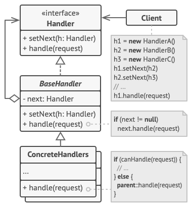

# Chain of responsibility
Chain of Responsibility is a behavioral design pattern that lets you pass requests along a chain of handlers. Upon receiving a request, each handler decides either to process the request or to pass it to the next handler in the chain.

## Overview
The chain of responsibility design pattern solves problems like:
- How to avoid coupling the sender of a request to its receiver?
- How to make it possible that more than one receiver can handle a request?

Implementing a request directly within the class that sends the request is inflexible because it couples the class to a particular receiver and makes it impossible to support multiple receivers.

The chain of responsibility design pattern describes how to solve such problems:
- Define a chain of receiver objects having the responsibility, depending on run-time conditions, to either handle a request or forward it to the next receiver on the chain (if any).

This enables us to send a request to a chain of receivers without having to know which one handles the request. The request gets passed along the chain until a receiver handles the request. The sender of a request is no longer coupled to a particular receiver.

## Structure

1. The `Handler` declares the interface, common for all concrete handlers. It usually contains just a single method for handling requests, but sometimes it may also have another method for setting the next handler on the chain.
2. The `Base Handler` is an optional class where you can put the boilerplate code that’s common to all handler classes.

   Usually, this class defines a field for storing a reference to the next handler. The clients can build a chain by passing a handler to the constructor or setter of the previous handler. The class may also implement the default handling behavior: it can pass execution to the next handler after checking for its existence.
3. `Concrete Handlers` contain the actual code for processing requests. Upon receiving a request, each handler must decide whether to process it and, additionally, whether to pass it along the chain.

   Handlers are usually self-contained and immutable, accepting all necessary data just once via the constructor.
4. The `Client` may compose chains just once or compose them dynamically, depending on the application’s logic. Note that a request can be sent to any handler in the chain—it doesn’t have to be the first one.

## Implementation
1. Declare the handler interface and describe the signature of a method for handling requests.

   Decide how the client will pass the request data into the method. The most flexible way is to convert the request into an object and pass it to the handling method as an argument.
2. To eliminate duplicate boilerplate code in concrete handlers, it might be worth creating an abstract base handler class, derived from the handler interface.

   This class should have a field for storing a reference to the next handler in the chain. Consider making the class immutable. However, if you plan to modify chains at runtime, you need to define a setter for altering the value of the reference field.

   You can also implement the convenient default behavior for the handling method, which is to forward the request to the next object unless there’s none left. Concrete handlers will be able to use this behavior by calling the parent method.
3. One by one create concrete handler subclasses and implement their handling methods. Each handler should make two decisions when receiving a request:

   - Whether it’ll process the request.
   - Whether it’ll pass the request along the chain.
4.The client may either assemble chains on its own or receive pre-built chains from other objects. In the latter case, you must implement some factory classes to build chains according to the configuration or environment settings.
5. The client may trigger any handler in the chain, not just the first one. The request will be passed along the chain until some handler refuses to pass it further or until it reaches the end of the chain.
6. Due to the dynamic nature of the chain, the client should be ready to handle the following scenarios:

   - The chain may consist of a single link.
   - Some requests may not reach the end of the chain.
   - Others may reach the end of the chain unhandled.