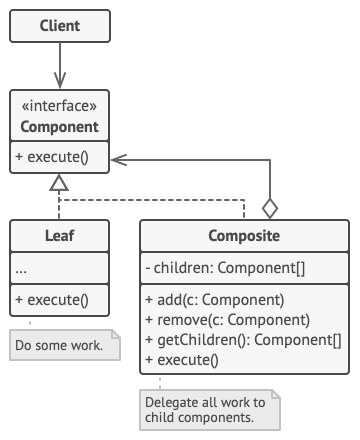

# Composite
Composite is a structural design pattern that lets you compose objects into tree structures and then work with these structures as if they were individual objects.

Using the Composite pattern makes sense only when the core model of your app can be represented as a tree.

## Overview
The composite design pattern solves problems like:
- How to represent a part-whole hierarchy so that clients can treat part and whole objects uniformly?
- How to represent a part-whole hierarchy as tree structure?

When defining `Part` objects and `Whole` objects that act as containers for `Part` objects, clients must treat them separately, which complicates client code.

The composite design pattern describes how to solve such problems:
- Define a unified `Component` interface for part (`Leaf`) objects and whole (`Composite`) objects.
- Individual `Leaf` objects implement the `Component` interface directly, and `Composite` objects forward requests to their child components.

This enables clients to work through the `Component` interface to treat `Leaf` and `Composite` objects uniformly: `Leaf` objects perform a request directly, and `Composite` objects forward the request to their child components recursively downwards the tree structure. This makes client classes easier to implement, change, test, and reuse.

## Structure

1. The `Component` interface describes operations that are common to both simple and complex elements of the tree.
2. The `Leaf` is a basic element of a tree that doesn’t have sub-elements.

   Usually, leaf components end up doing most of the real work, since they don’t have anyone to delegate the work to.
3. The `Container` (aka *composite*) is an element that has sub-elements: leaves or other containers. A container doesn’t know the concrete classes of its children. It works with all sub-elements only via the component interface.

   Upon receiving a request, a container delegates the work to its sub-elements, processes intermediate results and then returns the final result to the client.
4. The `Client` works with all elements through the component interface. As a result, the client can work in the same way with both simple or complex elements of the tree.

## Implementation
1. Make sure that the core model of your app can be represented as a tree structure. Try to break it down into simple elements and containers. Remember that containers must be able to contain both simple elements and other containers.
2. Declare the component interface with a list of methods that make sense for both simple and complex components.
3. Create a leaf class to represent simple elements. A program may have multiple different leaf classes.
4. Create a container class to represent complex elements. In this class, provide an array field for storing references to sub-elements. The array must be able to store both leaves and containers, so make sure it’s declared with the component interface type.
   > While implementing the methods of the component interface, remember that a container is supposed to be delegating most of the work to sub-elements.
5. Finally, define the methods for adding and removal of child elements in the container.
   > Keep in mind that these operations can be declared in the component interface. This would violate the Interface Segregation Principle because the methods will be empty in the leaf class. However, the client will be able to treat all the elements equally, even when composing the tree.