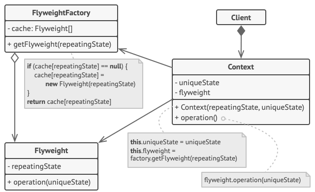

# Flyweight
Flyweight is a structural design pattern that lets you fit more objects into the available amount of RAM by sharing common parts of state between multiple objects instead of keeping all of the data in each object.

## Overview
The flyweight pattern is useful when dealing with a large number of objects that share simple repeated elements which would use a large amount of memory if they were individually embedded. It is common to hold shared data in external data structures and pass it to the objects temporarily when they are used.

A classic example are the data structures used representing characters in a word processor. Naively, each character in a document might have a glyph object containing its font outline, font metrics, and other formatting data. However, this would use hundreds or thousands of bytes of memory for each character. Instead, each character can have a reference to a glyph object shared by every instance of the same character in the document. This way, only the position of each character needs to be stored internally.

As a result, flyweight objects can:
- store intrinsic state that is invariant, context-independent and shareable (for example, the code of character 'A' in a given character set)
- provide an interface for passing in extrinsic state that is variant, context-dependent and can't be shared (for example, the position of character 'A' in a text document)

Clients can reuse Flyweight objects and pass in extrinsic state as necessary, reducing the number of physically created objects.

## Structure

1. The Flyweight pattern is merely an optimization. Before applying it, make sure your program does have the RAM consumption problem related to having a massive number of similar objects in memory at the same time. Make sure that this problem can’t be solved in any other meaningful way.
2. The `Flyweight` class contains the portion of the original object’s state that can be shared between multiple objects. The same flyweight object can be used in many different contexts. The state stored inside a flyweight is called *intrinsic*. The state passed to the flyweight’s methods is called *extrinsic*.
3. The `Context` class contains the extrinsic state, unique across all original objects. When a context is paired with one of the flyweight objects, it represents the full state of the original object.
4. Usually, the behavior of the original object remains in the flyweight class. In this case, whoever calls a flyweight’s method must also pass appropriate bits of the extrinsic state into the method’s parameters. On the other hand, the behavior can be moved to the context class, which would use the linked flyweight merely as a data object.
5. The `Client` calculates or stores the extrinsic state of flyweights. From the client’s perspective, a flyweight is a template object which can be configured at runtime by passing some contextual data into parameters of its methods.
6. The `Flyweight Factory` manages a pool of existing flyweights. With the factory, clients don’t create flyweights directly. Instead, they call the factory, passing it bits of the intrinsic state of the desired flyweight. The factory looks over previously created flyweights and either returns an existing one that matches search criteria or creates a new one if nothing is found.

## Implementation
1. Divide fields of a class that will become a flyweight into two parts:

   - the intrinsic state: the fields that contain unchanging data duplicated across many objects
   - the extrinsic state: the fields that contain contextual data unique to each object
2. Leave the fields that represent the intrinsic state in the class, but make sure they’re immutable. They should take their initial values only inside the constructor.
3. Go over methods that use fields of the extrinsic state. For each field used in the method, introduce a new parameter and use it instead of the field.
4. Optionally, create a factory class to manage the pool of flyweights. It should check for an existing flyweight before creating a new one. Once the factory is in place, clients must only request flyweights through it. They should describe the desired flyweight by passing its intrinsic state to the factory.
5. The client must store or calculate values of the extrinsic state (context) to be able to call methods of flyweight objects. For the sake of convenience, the extrinsic state along with the flyweight-referencing field may be moved to a separate context class.