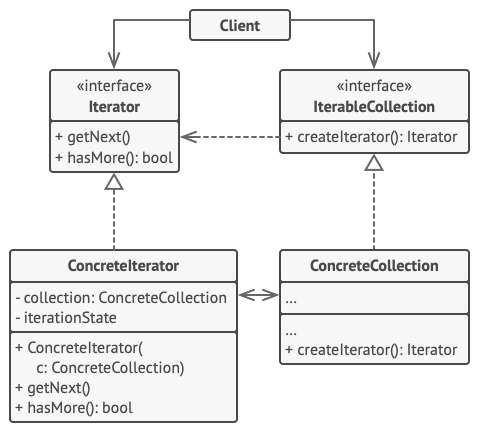

# Iterator
Iterator is a behavioral design pattern that lets you traverse elements of a collection without exposing its underlying representation (list, stack, tree, etc.).

## Overview
The iterator design pattern solves problems like:
- How to access and traverse elements of an aggregate object without exposing its representation (data structures)?
- How to define new traversal operations for an aggregate object without changing its interface?

Defining access and traversal operations in the aggregate interface is inflexible because it commits the aggregate to particular access and traversal operations and makes it impossible to add new operations later without having to change the aggregate interface.

The iterator design pattern describes how to solve such problems:
- Define a separate (iterator) object that encapsulates accessing and traversing an aggregate object.
- Clients use an iterator to access and traverse an aggregate without knowing its representation (data structures).

Different iterators can be used to access and traverse an aggregate in different ways.
New access and traversal operations can be defined independently by defining new iterators.

## Structure

1. The `Iterator` interface declares the operations required for traversing a collection: fetching the next element, retrieving the current position, restarting iteration, etc.
2. `Concrete Iterators` implement specific algorithms for traversing a collection. The iterator object should track the traversal progress on its own. This allows several iterators to traverse the same collection independently of each other.
3. The `Collection` interface declares one or multiple methods for getting iterators compatible with the collection. Note that the return type of the methods must be declared as the iterator interface so that the concrete collections can return various kinds of iterators.
4. `Concrete Collections` return new instances of a particular concrete iterator class each time the client requests one. You might be wondering, where’s the rest of the collection’s code? Don’t worry, it should be in the same class. It’s just that these details aren’t crucial to the actual pattern, so we’re omitting them.
5.The Client works with both collections and iterators via their interfaces. This way the client isn’t coupled to concrete classes, allowing you to use various collections and iterators with the same client code.

   Typically, clients don’t create iterators on their own, but instead get them from collections. Yet, in certain cases, the client can create one directly; for example, when the client defines its own special iterator.

## Implementation
1. Declare the iterator interface. At the very least, it must have a method for fetching the next element from a collection. But for the sake of convenience you can add a couple of other methods, such as fetching the previous element, tracking the current position, and checking the end of the iteration.
2. Declare the collection interface and describe a method for fetching iterators. The return type should be equal to that of the iterator interface. You may declare similar methods if you plan to have several distinct groups of iterators.
3. Implement concrete iterator classes for the collections that you want to be traversable with iterators. An iterator object must be linked with a single collection instance. Usually, this link is established via the iterator’s constructor.
4.Implement the collection interface in your collection classes. The main idea is to provide the client with a shortcut for creating iterators, tailored for a particular collection class. The collection object must pass itself to the iterator’s constructor to establish a link between them.
5. Go over the client code to replace all of the collection traversal code with the use of iterators. The client fetches a new iterator object each time it needs to iterate over the collection elements.