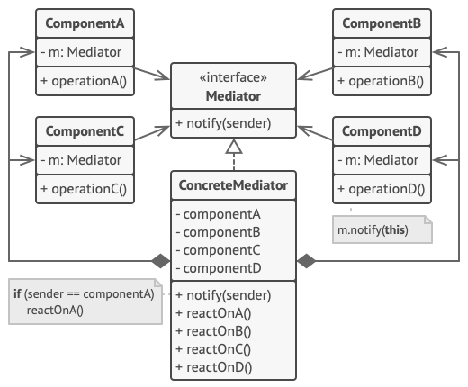

# Mediator
Mediator is a behavioral design pattern that lets you reduce chaotic dependencies between objects. The pattern restricts direct communications between the objects and forces them to collaborate only via a mediator object.

## Overview
The mediator design pattern solves problems like:
- How to avoid tight coupling between a set of interacting objects?
- How to to change the interaction between a set of objects independently?

Defining a set of interacting objects by accessing and updating each other directly is inflexible because it tightly couples the objects to each other and makes it impossible to change the interaction independently from (without having to change) the objects. And it stops the objects from being reusable and makes them hard to test.

Tightly coupled objects are hard to implement, change, test, and reuse because they refer to and know about many different objects.

The mediator design pattern describes how to solve such problems:
- Define a separate (mediator) object that encapsulates the interaction between a set of objects.
- Objects delegate their interaction to a mediator object instead of interacting with each other directly.

The objects interact with each other indirectly through a mediator object that controls and coordinates the interaction.

This makes the objects loosely coupled. They only refer to and know about their mediator object and have no explicit knowledge of each other.

## Structure

1. `Components` are various classes that contain some business logic. Each component has a reference to a mediator, declared with the type of the mediator interface. The component isn’t aware of the actual class of the mediator, so you can reuse the component in other programs by linking it to a different mediator.
2. The `Mediator` interface declares methods of communication with components, which usually include just a single notification method. Components may pass any context as arguments of this method, including their own objects, but only in such a way that no coupling occurs between a receiving component and the sender’s class.
3. `Concrete Mediators` encapsulate relations between various components. Concrete mediators often keep references to all components they manage and sometimes even manage their lifecycle.
4. `Components` must not be aware of other components. If something important happens within or to a component, it must only notify the mediator. When the mediator receives the notification, it can easily identify the sender, which might be just enough to decide what component should be triggered in return.

   From a component’s perspective, it all looks like a total black box. The sender doesn’t know who’ll end up handling its request, and the receiver doesn’t know who sent the request in the first place.

## Implementation
1. Identify a group of tightly coupled classes which would benefit from being more independent (e.g., for easier maintenance or simpler reuse of these classes).
2. Declare the mediator interface and describe the desired communication protocol between mediators and various components. In most cases, a single method for receiving notifications from components is sufficient.
   
   This interface is crucial when you want to reuse component classes in different contexts. As long as the component works with its mediator via the generic interface, you can link the component with a different implementation of the mediator.
3. Implement the concrete mediator class. Consider storing references to all components inside the mediator. This way, you could call any component from the mediator’s methods.
4.You can go even further and make the mediator responsible for the creation and destruction of component objects. After this, the mediator may resemble a `factory` or a `facade`.
5. Components should store a reference to the mediator object. The connection is usually established in the component’s constructor, where a mediator object is passed as an argument.
6. Change the components’ code so that they call the mediator’s notification method instead of methods on other components. Extract the code that involves calling other components into the mediator class. Execute this code whenever the mediator receives notifications from that component.