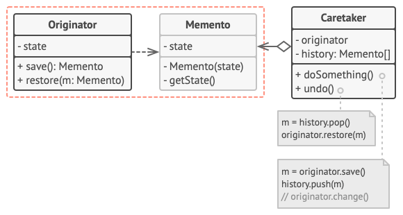
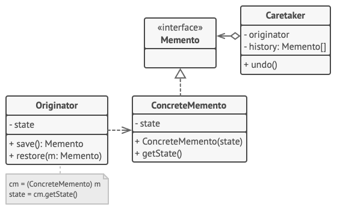
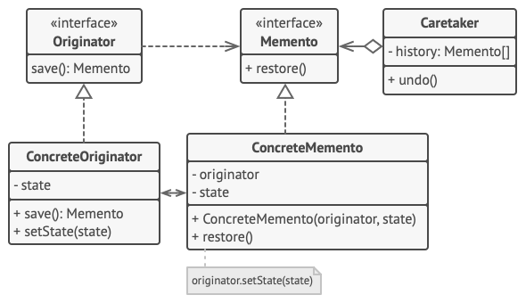

# Memento
Memento is a behavioral design pattern that lets you save and restore the previous state of an object without revealing the details of its implementation.

## Overview
The memento design pattern solves problems like:
- How to produce snapshots of the object’s state to be able to restore a previous state of the object?
- How to avoid direct access to the object’s fields/getters/setters which violates its encapsulation?

The memento pattern is implemented with three objects: the originator, a caretaker and a memento. The originator is some object that has an internal state. The caretaker is going to do something to the originator, but wants to be able to undo the change. The caretaker first asks the originator for a memento object. Then it does whatever operation (or sequence of operations) it was going to do. To roll back to the state before the operations, it returns the memento object to the originator. The memento object itself is an opaque object (one which the caretaker cannot, or should not, change). When using this pattern, care should be taken if the originator may change other objects or resources — the memento pattern operates on a single object.

## Structure
### Implementation based on nested classes
The classic implementation of the pattern relies on support for nested classes, available in many popular programming languages (such as C++, C#, and Java).

1. The `Originator` class can produce snapshots of its own state, as well as restore its state from snapshots when needed.
2. The `Memento` is a value object that acts as a snapshot of the originator’s state. It’s a common practice to make the memento immutable and pass it the data only once, via the constructor.
3. The `Caretaker` knows not only “when” and “why” to capture the originator’s state, but also when the state should be restored.

   A caretaker can keep track of the originator’s history by storing a stack of mementos. When the originator has to travel back in history, the caretaker fetches the topmost memento from the stack and passes it to the originator’s restoration method.
4. In this implementation, the memento class is nested inside the originator. This lets the originator access the fields and methods of the memento, even though they’re declared private. On the other hand, the caretaker has very limited access to the memento’s fields and methods, which lets it store mementos in a stack but not tamper with their state.

### Implementation based on an intermediate interface
There’s an alternative implementation, suitable for programming languages that don’t support nested classes (PHP).

1.In the absence of nested classes, you can restrict access to the memento’s fields by establishing a convention that caretakers can work with a memento only through an explicitly declared intermediary interface, which would only declare methods related to the memento’s metadata.
2. On the other hand, originators can work with a memento object directly, accessing fields and methods declared in the memento class. The downside of this approach is that you need to declare all members of the memento public.

### Implementation with even stricter encapsulation
There’s another implementation which is useful when you don’t want to leave even the slightest chance of other classes accessing the state of the originator through the memento.

1. This implementation allows having multiple types of originators and mementos. Each originator works with a corresponding memento class. Neither originators nor mementos expose their state to anyone.
2. Caretakers are now explicitly restricted from changing the state stored in mementos. Moreover, the caretaker class becomes independent from the originator because the restoration method is now defined in the memento class.
3. Each memento becomes linked to the originator that produced it. The originator passes itself to the memento’s constructor, along with the values of its state. Thanks to the close relationship between these classes, a memento can restore the state of its originator, given that the latter has defined the appropriate setters.

## Implementation
1. Determine what class will play the role of the originator. It’s important to know whether the program uses one central object of this type or multiple smaller ones.
2. Create the memento class. One by one, declare a set of fields that mirror the fields declared inside the originator class.
3. Make the memento class immutable. A memento should accept the data just once, via the constructor. The class should have no setters.
4.If your programming language supports nested classes, nest the memento inside the originator. If not, extract a blank interface from the memento class and make all other objects use it to refer to the memento. You may add some metadata operations to the interface, but nothing that exposes the originator’s state.
5. Add a method for producing mementos to the originator class. The originator should pass its state to the memento via one or multiple arguments of the memento’s constructor.

   The return type of the method should be of the interface you extracted in the previous step (assuming that you extracted it at all). Under the hood, the memento-producing method should work directly with the memento class.
6. Add a method for restoring the originator’s state to its class. It should accept a memento object as an argument. If you extracted an interface in the previous step, make it the type of the parameter. In this case, you need to typecast the incoming object to the memento class, since the originator needs full access to that object.
7. The caretaker, whether it represents a command object, a history, or something entirely different, should know when to request new mementos from the originator, how to store them and when to restore the originator with a particular memento.
8. The link between caretakers and originators may be moved into the memento class. In this case, each memento must be connected to the originator that had created it. The restoration method would also move to the memento class. However, this would all make sense only if the memento class is nested into originator or the originator class provides sufficient setters for overriding its state.