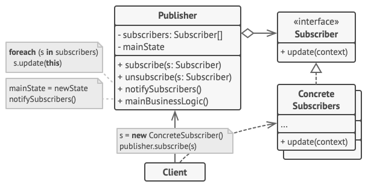

# Observer
Observer is a behavioral design pattern that lets you define a subscription mechanism to notify multiple objects about any events that happen to the object they’re observing.

## Overview
The observer design pattern solves problems like:
- How to define a one-to-many dependency between objects without making the objects tightly coupled?
- How to update an open-ended number of dependent objects automatically, when one object changes state?
- How can an object notify multiple other objects?

The naive approach would be for one object (subject) to directly call specific methods on each dependent object. This creates tight coupling because the subject must know the concrete types and specific interfaces of all dependent objects, making the code inflexible and hard to extend. However, this direct approach may be preferable in performance-critical scenarios (such as low-level kernel structures or real-time systems) where the overhead of abstraction is unacceptable and compile-time optimization is crucial.

The observer pattern provides a more flexible alternative by establishing a standard notification protocol:
- Define `Subject` (`Publisher`) and `Observer` objects with standardized interfaces.
- When a subject changes state, all registered observers are notified and updated automatically.
- The subject manages its own state while also maintaining a list of observers and notifying them of state changes by calling their `update()` operation.
- The responsibility of observers is to register and unregister themselves with a subject (in order to be notified of state changes) and to update their state (to synchronize it with the subject's state) when they are notified.

This approach makes subject and observers loosely coupled through interface standardization. The subject only needs to know that observers implement the `update()` method—it has no knowledge of observers' concrete types or internal implementation details. Observers can be added and removed independently at run time.

## Structure

1. The `Publisher` issues events of interest to other objects. These events occur when the publisher changes its state or executes some behaviors. Publishers contain a subscription infrastructure that lets new subscribers join and current subscribers leave the list.
2. When a new event happens, the publisher goes over the subscription list and calls the notification method declared in the subscriber interface on each subscriber object.
3. The `Subscriber` interface declares the notification interface. In most cases, it consists of a single `update` method. The method may have several parameters that let the publisher pass some event details along with the update.
4. `Concrete Subscribers` perform some actions in response to notifications issued by the publisher. All of these classes must implement the same interface so the publisher isn’t coupled to concrete classes.
5. Usually, subscribers need some contextual information to handle the update correctly. For this reason, publishers often pass some context data as arguments of the notification method. The publisher can pass itself as an argument, letting subscriber fetch any required data directly.
6. The `Client` creates publisher and subscriber objects separately and then registers subscribers for publisher updates.

## Implementation
1. Look over your business logic and try to break it down into two parts: the core functionality, independent from other code, will act as the publisher; the rest will turn into a set of subscriber classes.
2. Declare the subscriber interface. At a bare minimum, it should declare a single `update` method.
3. Declare the publisher interface and describe a pair of methods for adding a subscriber object to and removing it from the list. Remember that publishers must work with subscribers only via the subscriber interface.
4.Decide where to put the actual subscription list and the implementation of subscription methods. Usually, this code looks the same for all types of publishers, so the obvious place to put it is in an abstract class derived directly from the publisher interface. Concrete publishers extend that class, inheriting the subscription behavior.

   However, if you’re applying the pattern to an existing class hierarchy, consider an approach based on composition: put the subscription logic into a separate object, and make all real publishers use it.
5. Create concrete publisher classes. Each time something important happens inside a publisher, it must notify all its subscribers.
6. Implement the update notification methods in concrete subscriber classes. Most subscribers would need some context data about the event. It can be passed as an argument of the notification method.

   But there’s another option. Upon receiving a notification, the subscriber can fetch any data directly from the notification. In this case, the publisher must pass itself via the update method. The less flexible option is to link a publisher to the subscriber permanently via the constructor.
7. The client must create all necessary subscribers and register them with proper publishers.