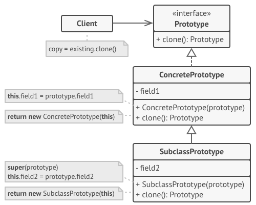
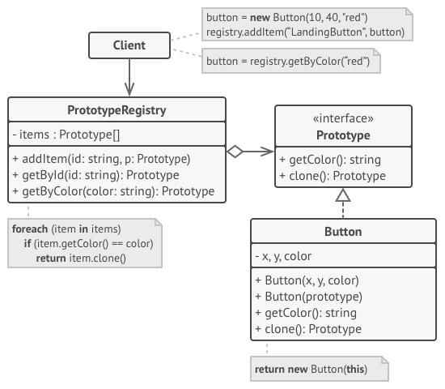

# Prototype
Prototype is a creational design pattern that lets you copy existing objects without making your code dependent on their classes.

## Overview
The prototype design pattern solves problems like:
- How can objects be created so that the specific type of object can be determined at runtime?
- How can dynamically loaded classes be instantiated?

Creating objects directly within the class that requires (uses) the objects is inflexible because it commits the class to particular objects at compile-time and makes it impossible to specify which objects to create at run-time.

The prototype design pattern describes how to solve such problems:
- Define a `Prototype` object that returns a copy of itself.
- Create new objects by copying a `Prototype` object.

## Structure

1. The `Prototype` interface declares the cloning methods. In most cases, it’s a single `clone` method.
2. The `Concrete Prototype` class implements the cloning method. In addition to copying the original object’s data to the clone, this method may also handle some edge cases of the cloning process related to cloning linked objects, untangling recursive dependencies, etc.
3. The `Client` can produce a copy of any object that follows the prototype interface.

1. The `Prototype Registry` provides an easy way to access frequently-used prototypes. It stores a set of pre-built objects that are ready to be copied. The simplest prototype registry is a `name → prototype` hash map. However, if you need better search criteria than a simple name, you can build a much more robust version of the registry.

## Implementation
1. Create the prototype interface and declare the `clone` method in it. Or just add the method to all classes of an existing class hierarchy, if you have one.
2. A prototype class must define the alternative constructor that accepts an object of that class as an argument. The constructor must copy the values of all fields defined in the class from the passed object into the newly created instance. If you’re changing a subclass, you must call the parent constructor to let the superclass handle the cloning of its private fields.
   > If your programming language doesn’t support method overloading, you won’t be able to create a separate “prototype” constructor. Thus, copying the object’s data into the newly created clone will have to be performed within the `clone` method. Still, having this code in a regular constructor is safer because the resulting object is returned fully configured right after you call the `new` operator.
3. The cloning method usually consists of just one line: running a `new` operator with the prototypical version of the constructor. Note, that every class must explicitly override the cloning method and use its own class name along with the `new` operator. Otherwise, the cloning method may produce an object of a parent class.
4. Optionally, create a centralized prototype registry to store a catalog of frequently used prototypes.
   > You can implement the registry as a new factory class or put it in the base prototype class with a static method for fetching the prototype. This method should search for a prototype based on search criteria that the client code passes to the method. The criteria might either be a simple string tag or a complex set of search parameters. After the appropriate prototype is found, the registry should clone it and return the copy to the client.

   > Finally, replace the direct calls to the subclasses’ constructors with calls to the factory method of the prototype registry.