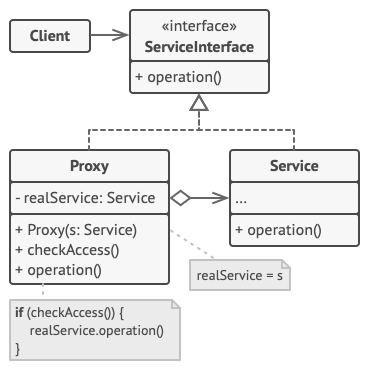

# Proxy
Proxy is a structural design pattern that lets you provide a substitute or placeholder for another object. A proxy controls access to the original object, allowing you to perform something either before or after the request gets through to the original object.

## Overview
The proxy design pattern solves problems like:
- How should the access to an object be controlled?
- How should additional functionality when accessing an object be provided?

The proxy could interface to anything: a network connection, a large object in memory, a file, or some other resource that is expensive or impossible to duplicate. In short, a proxy is a wrapper or agent object that is being called by the client to access the real serving object behind the scenes. Use of the proxy can simply be forwarding to the real object, or can provide additional logic. In the proxy, extra functionality can be provided, for example caching when operations on the real object are resource intensive, or checking preconditions before operations on the real object are invoked. For the client, usage of a proxy object is similar to using the real object, because both implement the same interface.

## Structure

1. The `Service Interface` declares the interface of the Service. The proxy must follow this interface to be able to disguise itself as a service object.
2. The `Service` is a class that provides some useful business logic.
3. The `Proxy` class has a reference field that points to a service object. After the proxy finishes its processing (e.g., lazy initialization, logging, access control, caching, etc.), it passes the request to the service object.

   Usually, proxies manage the full lifecycle of their service objects.
4. The `Client` should work with both services and proxies via the same interface. This way you can pass a proxy into any code that expects a service object.

## Implementation
1. If there’s no pre-existing service interface, create one to make proxy and service objects interchangeable. Extracting the interface from the service class isn’t always possible, because you’d need to change all of the service’s clients to use that interface. Plan B is to make the proxy a subclass of the service class, and this way it’ll inherit the interface of the service.
2. Create the proxy class. It should have a field for storing a reference to the service. Usually, proxies create and manage the whole life cycle of their services. On rare occasions, a service is passed to the proxy via a constructor by the client.
3. Implement the proxy methods according to their purposes. In most cases, after doing some work, the proxy should delegate the work to the service object.
4.Consider introducing a creation method that decides whether the client gets a proxy or a real service. This can be a simple static method in the proxy class or a full-blown factory method.
5. Consider implementing lazy initialization for the service object.