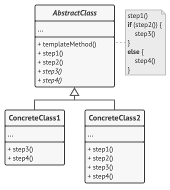

# Template method
Template Method is a behavioral design pattern that defines the skeleton of an algorithm in the superclass but lets subclasses override specific steps of the algorithm without changing its structure.

## Overview
The template method design pattern solves problems like:
- How to define the skeleton of an algorithm while allowing parts of it to vary?
- How to reuse common algorithm structure while letting subclasses customize specific steps?
- How to avoid duplicating code across similar algorithms?

Defining complete algorithms separately in each class is inflexible because it duplicates shared logic and tightly couples variations of the algorithm to concrete implementations. This makes the code harder to maintain, harder to change consistently, and more error-prone.

When each class implements its own version of an algorithm:
- Common steps are duplicated.
- Changes to the algorithm structure must be repeated in many places.
- It becomes difficult to enforce a consistent execution order.

The template method design pattern describes how to solve such problems:
- Define the overall algorithm structure in a base class using a template method.
- Defer specific steps of the algorithm to subclasses.
- Allow subclasses to redefine certain steps without changing the algorithm’s structure.

The base class defines the algorithm and its order using a template method. Some steps are fixed, some must be implemented by subclasses (abstract methods), and some are optional or have default behavior (default and hook methods).

This makes the algorithm reusable and extensible. The high-level logic is fixed in one place, while subclasses can customize behavior by overriding selected steps, without affecting the overall flow.

## Structure

1. The `Abstract Class` declares methods that act as steps of an algorithm, as well as the actual template method which calls these methods in a specific order. The steps may either be declared `abstract` or have some default implementation.
2. `Concrete Classes` can override all of the steps, but not the template method itself.

## Implementation
1. Analyze the target algorithm to see whether you can break it into steps. Consider which steps are common to all subclasses and which ones will always be unique.
2. Create the abstract base class and declare the template method and a set of abstract methods representing the algorithm’s steps. Outline the algorithm’s structure in the template method by executing corresponding steps. Consider making the template method `final` to prevent subclasses from overriding it.
3. It’s okay if all the steps end up being abstract. However, some steps might benefit from having a default implementation. Subclasses don’t have to implement those methods.
4.Think of adding hooks between the crucial steps of the algorithm.
5. For each variation of the algorithm, create a new concrete subclass. It *must* implement all of the abstract steps, but *may* also override some of the optional ones.