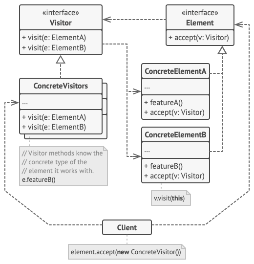

# Visitor
Visitor is a behavioral design pattern that lets you separate algorithms from the objects on which they operate.

## Overview
The visitor design pattern solves problems like:
- How to define a new operation for (some) classes of an object structure without changing the classes?

When new operations are needed frequently and the object structure consists of many unrelated classes, it's inflexible to add new subclasses each time a new operation is required because "[..] distributing all these operations across the various node classes leads to a system that's hard to understand, maintain, and change."

The visitor design pattern describes how to solve such a problem:
- Define a separate (visitor) object that implements an operation to be performed on elements of an object structure.
- Clients traverse the object structure and call a dispatching operation accept (visitor) on an element — that "dispatches" (delegates) the request to the "accepted visitor object". The visitor object then performs the operation on the element ("visits the element").

This makes it possible to create new operations independently from the classes of an object structure by adding new visitor objects.

## Structure

1. The `Visitor` interface declares a set of visiting methods that can take concrete elements of an object structure as arguments. These methods may have the same names if the program is written in a language that supports overloading, but the type of their parameters must be different.
2. Each `Concrete Visitor` implements several versions of the same behaviors, tailored for different concrete element classes.
3. The `Element` interface declares a method for “accepting” visitors. This method should have one parameter declared with the type of the visitor interface.
4. Each `Concrete Element` must implement the acceptance method. The purpose of this method is to redirect the call to the proper visitor’s method corresponding to the current element class. Be aware that even if a base element class implements this method, all subclasses must still override this method in their own classes and call the appropriate method on the visitor object.
5. The `Client` usually represents a collection or some other complex object (for example, a Composite tree). Usually, clients aren’t aware of all the concrete element classes because they work with objects from that collection via some abstract interface.

## Implementation
1. Declare the visitor interface with a set of “visiting” methods, one per each concrete element class that exists in the program.
2. Declare the element interface. If you’re working with an existing element class hierarchy, add the abstract “acceptance” method to the base class of the hierarchy. This method should accept a visitor object as an argument.
3. Implement the acceptance methods in all concrete element classes. These methods must simply redirect the call to a visiting method on the incoming visitor object which matches the class of the current element.
4.The element classes should only work with visitors via the visitor interface. Visitors, however, must be aware of all concrete element classes, referenced as parameter types of the visiting methods.
5. For each behavior that can’t be implemented inside the element hierarchy, create a new concrete visitor class and implement all of the visiting methods.

   You might encounter a situation where the visitor will need access to some private members of the element class. In this case, you can either make these fields or methods public, violating the element’s encapsulation, or nest the visitor class in the element class. The latter is only possible if you’re lucky to work with a programming language that supports nested classes.
6. The client must create visitor objects and pass them into elements via “acceptance” methods.